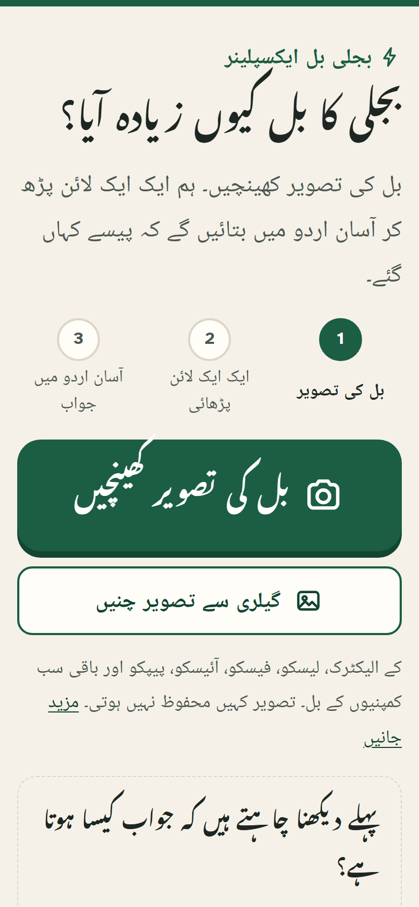
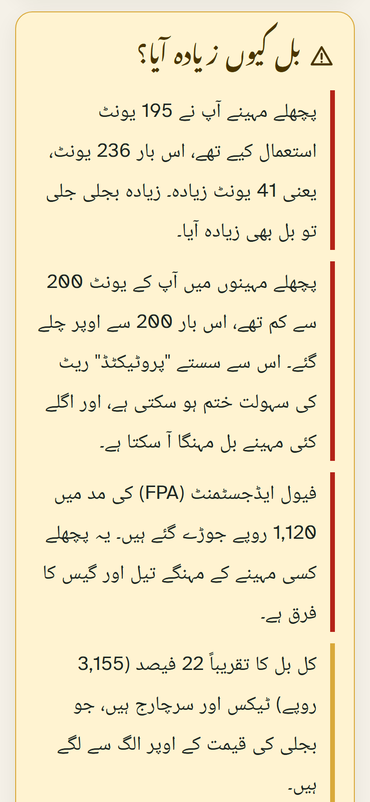
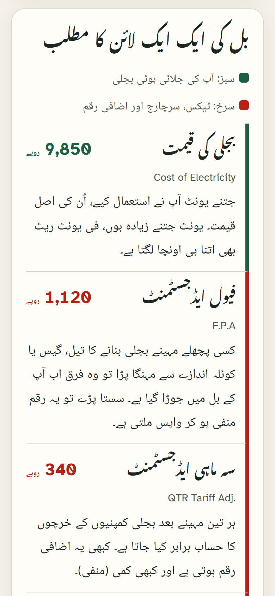

# بجلی بل ایکسپلینر · Bijli Bill Explainer

### [▶ Open the live app](https://bijli-bill-explainer.vercel.app/)

Pakistani electricity bills are full of lines that even grown children struggle
to explain to their parents: FPA, QTR, F.C. Surcharge, Electricity Duty, GST,
and a units total that quietly crossed a slab. This Urdu-first web app takes a
photo of the bill (K-Electric, LESCO, FESCO, IESCO, PEPCO and the other
distribution companies) and explains, line by line in plain Urdu, where the
money went and **why the bill went up**.

**Live app:** [bijli-bill-explainer.vercel.app](https://bijli-bill-explainer.vercel.app/)

<p>
  
  
  
</p>

*Screenshots show the app's built-in sample bill, which is made up and labelled as a sample.*

## How it works

1. **Photo.** One large camera button (plus "choose from gallery"). Before the
   first upload, a one-time Urdu notice explains that the photo goes to an AI
   service and suggests covering the name and address.
2. **Read every line.** The browser shrinks the photo and re-encodes it as JPEG,
   which also strips EXIF data such as GPS location. `POST /api/explain` (a
   Vercel function) checks the bytes, sends the image to a free vision model and
   validates the JSON it returns.
3. **Explain in Urdu.** The app, not the model, writes every sentence.

### Why the model only reads numbers

The model's only job is transcription: amounts, units, the bill month and the
monthly history table, each line mapped to one of 18 known keys (`fpa`, `qta`,
`fc_surcharge`, `gst`…). The Urdu meaning of each line comes from a fixed
dictionary (`src/lib/dictionary.js`). "Why did it go up?" is worked out by
plain rules in `src/lib/explain.js`:

- units compared with last month, from the bill's own history table;
- crossing **200 units** after six months below it (losing "protected" status);
- crossing a 100-unit slab boundary;
- a fuel price adjustment or quarterly adjustment of 5% of the bill or more,
  and negative ones shown as credits;
- taxes and surcharges that are 15% of the bill or more;
- arrears and late payment surcharge.

So the model cannot invent an explanation, and every rule has a unit test. If
the lines don't add up to the total (a sign something was misread), the result
says so and asks the reader to compare with the paper bill.

## Features

- **Urdu first, made for older eyes.** Noto Nastaliq Urdu headings with
  `line-height: 2.2`, Noto Naskh body text, and Atkinson Hyperlegible (designed
  for low-vision readers) for amounts. Large text, tap targets of 64px or
  more, and a 104px camera button.
- **Colour that means something.** Green is the electricity you used; crimson
  is taxes, surcharges and charges on top of it. A legend says so in Urdu.
- **Every state handled.** Preparing, reading (skeleton), slow network after
  15 seconds, cancel, offline, not a bill, unreadable photo, wrong file type,
  too large, rate limited, AI busy (with retry), service not configured (offers
  the sample bill).
- **Sample bill.** A clearly labelled, made-up bill shows the full result
  without uploading anything.
- **Glossary and help.** Every term the app knows, how to take a readable photo,
  and an FAQ, all of which work offline.
- **Private by default.** Nothing is stored on the server. Only a "consent
  seen" flag is kept in `localStorage`.

## Run it locally

Requires Node 20 or newer.

```bash
npm install
cp .env.example .env.local   # then add your AI_API_KEY
npm run dev                  # http://localhost:5173
```

A Vite plugin serves `/api/explain` from `npm run dev` and `npm run preview`
the same way Vercel does. Without a key, uploads show the "service not
configured" state and the sample bill still works.

| Variable | Required | Default |
| --- | --- | --- |
| `AI_API_KEY` | yes | none. A free [OpenRouter key](https://openrouter.ai/keys) works |
| `AI_BASE_URL` | no | `https://openrouter.ai/api/v1` (any OpenAI-compatible endpoint, e.g. Gemini's) |
| `AI_MODEL` | no | `qwen/qwen3.8-27b:free,google/gemma-4-31b-it:free` (tried in order) |

Free models on OpenRouter change over time and have daily request limits; if
reads start failing with "AI service busy", check that the models in
`AI_MODEL` are still listed as free and accept images.

## Checks

```bash
npm run lint
npm test          # API validation, rate limiter, explanation rules
npm run build
npm run e2e       # Playwright, phone (375px) and desktop; first time: npx playwright install chromium
```

The end-to-end tests mock `/api/explain` and upload a generated sample bill
(`npm run fixture` rebuilds it).
`npm run capture` regenerates the icons, social image and screenshots against
a running preview.

## Security

- The server accepts only `image/jpeg`, `image/png` and `image/webp`, checks the
  file's magic bytes rather than the declared type, caps uploads at 4 MB and
  stores nothing.
- Model output is parsed and validated against a fixed schema; unknown keys
  become "other", labels are length-capped and stripped of control and bidi
  override characters, and React escapes everything rendered.
- Clients only ever see short error codes; details are logged server-side.
- A per-IP limiter (4 a minute, 25 a day) runs in each function instance. It is
  best effort, because instances don't share memory. For a hard limit, add a
  Vercel Firewall rate-limit rule on `/api/explain`.
- Strict CSP (`'self'` only), `frame-ancestors 'none'`, `nosniff`, HSTS and a
  restrictive `Permissions-Policy` are set in `vercel.json`.

See [SECURITY.md](SECURITY.md) to report a problem.

## Privacy and accuracy

Bill photos include the customer's name, address and reference number. The app
does not store them, but free AI tiers may keep or use submitted images to
improve their models, and the app says so before the first upload. For real
household use, set `AI_MODEL` to a paid model whose provider does not train on
inputs.

AI can misread a number, and tariff rules change. The app tells people to check
amounts against the paper bill before paying or complaining. It is not
affiliated with any distribution company, NEPRA or the government.

## Project structure

```
api/explain.js          Vercel function (POST /api/explain)
api/_lib/               handler, image sniffing, rate limiter, model call, schema validation
src/lib/dictionary.js   Urdu meaning of every bill line
src/lib/explain.js      rules that explain why the bill went up
src/lib/photo.js        in-browser resize and EXIF strip
src/screens/            home, result, help, privacy, terms, 404
e2e/                    Playwright tests and the generated sample bill photo
scripts/                prerender, screenshot capture, fixture generator
```

## License

[MIT](LICENSE)
